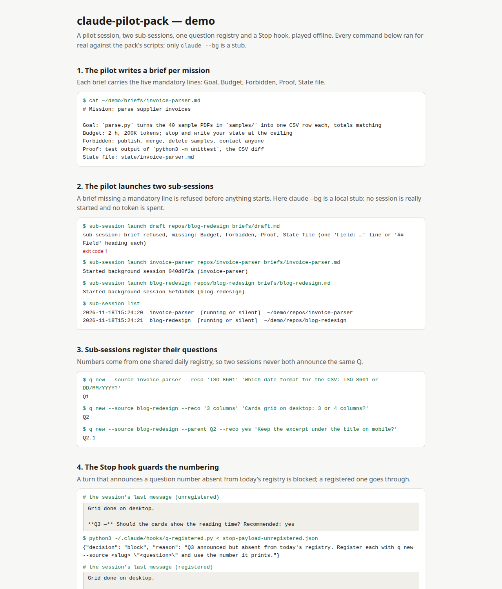

# claude-pilot-pack

Run many Claude Code sessions while talking to only one.

Three pieces, in any Git repository:

1. **Pilot** — one long-lived Claude Code session, the only window where you answer. It splits your requests
   into missions, writes a brief per mission and launches a sub-session for each.
2. **Sub-sessions** — background sessions (`claude --bg`) started from a validated brief. They never ask you
   anything: they register each question in a numbered daily registry, send it to the pilot and keep working.
   You can still open one directly; it keeps routing its questions to the pilot.
   They keep a state file on disk and end with a report whose five sections are enforced.
3. **Voice sessions** — the pilot prepares a short decision dossier, you open it in the Claude app on your
   phone and decide out loud, the pilot brings the transcript back and applies the decisions.

```
            you
             │  answers questions in batches
             ▼
          ┌──────┐   brief + launch    ┌──────────────┐
          │pilot │ ──────────────────▶ │ sub-session A│──┐
          │      │ ◀── Q<n>, report ── └──────────────┘  │  q new …   ┌──────────────────┐
          │      │                     ┌──────────────┐  ├──────────▶ │ question registry │
          │      │ ◀────────────────── │ sub-session B│──┘            │  Q1, Q2, Q2.1 …   │
          └──────┘                     └──────────────┘               └──────────────────┘
             │ dossier (≤ 15 items)
             ▼
     Claude app, voice mode  ──transcript──▶ pilot applies, q answer …
```

## What is in the pack

| Path | What |
|---|---|
| `templates/CLAUDE.pilot.md` | rules for the pilot session, to put in your pilot repo's `CLAUDE.md` |
| `templates/brief.md` | mission brief with its mandatory lines: Goal, Budget, Forbidden, Proof, State file |
| `templates/state-file.md` | state file a sub-session keeps up to date |
| `skills/sub-session/` | skill + `sub-session` script: launch, list, store a report |
| `skills/question-registry/` | skill + `q` script: daily numbered questions, answers, open list |
| `skills/voice-session/` | skill + dossier template: prepare, bring back, apply |
| `skills/use-cases/` | method skill: write replayable use cases (role → moment → scenario), anti-usage included |
| `skills/isolated-bench/` | method skill + runner: play the use cases with the real Claude Code CLI in a fresh container |
| `hooks/q-registered.py` | Stop hook: blocks a turn that announces `Q<n> —` absent from the registry |

Requirements: Claude Code with background sessions (`claude --bg`, `claude agents`) and SendMessage between
sessions, Git, Python 3.10+. No other dependency. Linux and macOS.

## Set-up

```bash
git clone <this repo> ~/claude-pilot-pack
cd ~/claude-pilot-pack

# 1. Skills
mkdir -p ~/.claude/skills
cp -r skills/* ~/.claude/skills/

# 2. Scripts on the PATH
mkdir -p ~/.local/bin
ln -sf ~/.claude/skills/sub-session/scripts/sub-session ~/.local/bin/sub-session
ln -sf ~/.claude/skills/question-registry/scripts/q ~/.local/bin/q

# 3. Hook
mkdir -p ~/.claude/hooks
cp hooks/q-registered.py ~/.claude/hooks/
```

4. Declare the hook in `~/.claude/settings.json`:

   ```json
   {
     "hooks": {
       "Stop": [
         { "hooks": [ { "type": "command", "command": "python3 ~/.claude/hooks/q-registered.py" } ] }
       ]
     }
   }
   ```

5. Create the pilot repo and start the pilot:

   ```bash
   mkdir -p ~/pilot && cd ~/pilot && git init
   cp ~/claude-pilot-pack/templates/CLAUDE.pilot.md CLAUDE.md
   cp -r ~/claude-pilot-pack/templates .
   claude --name pilot
   ```

6. Open `claude` once in every repo a sub-session will work in and accept the trust prompt: `claude --bg`
   refuses a folder never trusted ("Workspace not trusted").

7. Give the pilot a mission. It writes the brief, then runs `sub-session launch <slug> <repo> <brief.md>`.
   Later: "prepare a voice session", then "bring the voice session back".

All state lives in `PILOT_DIR` (default `~/.local/state/claude-pilot`): `questions/`, `sub-sessions.tsv`,
`reports/`. To move it (for example inside the pilot repo, to version it), set it once in the `env` block of
`~/.claude/settings.json`, so the pilot, every background session and the hook all see the same value:

```json
{ "env": { "PILOT_DIR": "/path/to/pilot/state" } }
```

## Check the install

```bash
PILOT_DIR=$(mktemp -d) q new --source test "Does the registry work?"   # prints Q1, in a throwaway registry
python3 -m unittest discover -s tests              # from the pack folder; uses a fake claude, spends no tokens
```

## Try it without installing

An offline demo plays a short pilot scenario with the real scripts and a stub in place of `claude`, then writes
it as a page (`out/index.html`):

```bash
git clone <this repo> claude-pilot-pack && cd claude-pilot-pack
mkdir -p out && docker build -t claude-pilot-pack .
docker run --rm -v "$PWD/out:/out" claude-pilot-pack
```

Without Docker: `python3 demo/run.py --out out`. Step-by-step instructions for coding agents: `AGENTS.md`.



## Resources to connect

- **No port**: nothing listens on the network; the scripts and the hook are short-lived commands.
- **Claude Code CLI** with background sessions (`claude --bg`) and SendMessage between sessions.
- **Disk**: writes only to `PILOT_DIR` and `~/.claude`.
- **No API key of its own**: Claude Code uses your existing account; the pack sends nothing anywhere itself.

## Why these rules

- **One window to answer in.** With many sessions open you get lost, or spend a lot of energy switching
  between them. Sub-sessions never ask you directly: the pilot batches their questions, recommendation first.
- **A budget per mission, short batches in fresh sessions, state written on disk.** Long unbounded sessions
  spend most of their tokens re-reading their own context.
- **One shared registry.** Without it, two sessions both announce "Q3"; the hook refuses an unregistered number.
- **Autonomy over micromanagement.** A session with clear rules for autonomy and reporting does better than one
  steered step by step, and leaves you free for the real subjects.

## Optional extensions (not in the pack)

- **Brainstorm levels** chosen per request (a short one for a bounded change, a full design for a large one),
  and a **model chosen per sub-session**.
- An **inbox** where sessions drop finished reports and pictures, to read away from the desk.
- A **remote approval portal**: a page where the human clicks "run" on a command a session prepared but must
  not run itself (passwords, root).
- **Browser automation** to open the voice conversation and fetch its transcript.
- **Connectors to your services**, through MCP or a driven browser; with a browser, have Claude write a playbook
  per site so it does not explore the site again next time.

## Licence

See `LICENSE`.
